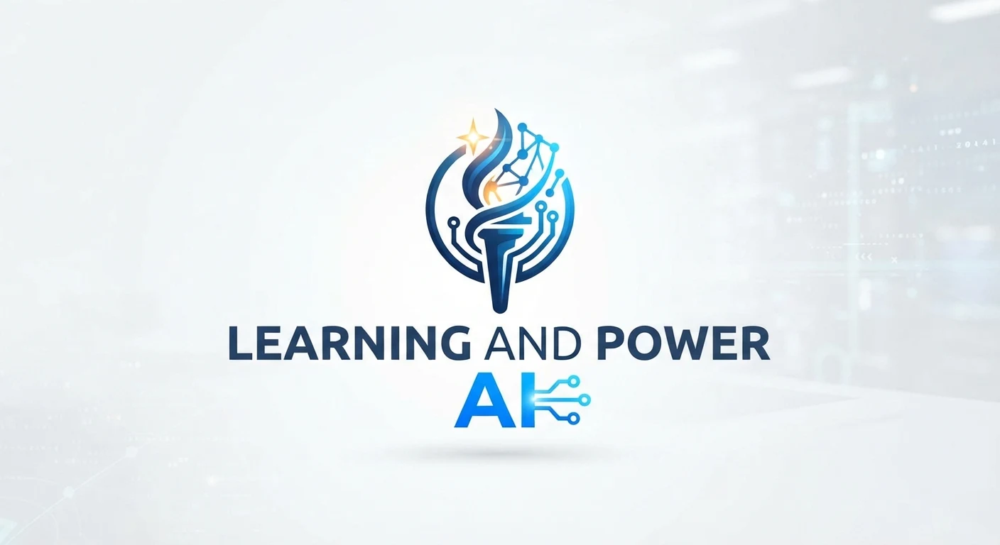

# Learning & Power AI

Learning & Power AI (L&P AI) is a full-stack learning platform for creating and taking courses, tracking lesson progress, managing users, and translating code or human language with Gemini or Groq AI.



## Features

### Learning platform

- Role-based access for students, instructors, and super admins
- Course browsing and publishing
- Video lessons, written content, PDFs, and downloadable materials
- Enrollment and lesson-by-lesson progress tracking
- Separate dashboards for students, instructors, and administrators
- Supabase authentication and row-level security

### AI translator

- Translate between human languages
- Translate code between programming languages
- Custom translation instructions
- Streaming responses
- Gemini and Groq provider support
- Optional user-provided API keys
- Signed-in user authorization
- Translation history stored in Supabase

### Administration

- Manage platform settings
- Approve or manage instructor access
- Promote or deactivate users
- Configure registration and translator availability
- Publish platform announcements

## Tech stack

- **Framework:** Next.js 16 Pages Router
- **Language:** TypeScript
- **UI:** React 18, Tailwind CSS, Radix UI, Lucide React
- **Backend and database:** Supabase PostgreSQL, Auth, Storage, and Row-Level Security
- **AI:** Google Gemini and Groq API
- **Editor:** CodeMirror
- **Deployment:** Docker and Docker Compose

## Project structure

```text
components/          Shared React components and UI primitives
lib/                 Supabase, authentication, and storage helpers
pages/               Next.js routes, dashboards, and API endpoints
public/              Static assets
styles/              Global Tailwind CSS styles
supabase/            Database schema and migrations
types/               Shared TypeScript types
utils/               AI provider and application utilities
```

Key routes include:

| Route | Purpose |
| --- | --- |
| `/` | Landing page |
| `/courses` | Published course catalog |
| `/courses/[id]` | Course details |
| `/learn/[id]` | Course learning interface |
| `/translator` | AI translation workspace |
| `/dashboard/student` | Student dashboard |
| `/dashboard/instructor` | Instructor dashboard |
| `/dashboard/admin` | Super admin dashboard |
| `/login` | Sign in |
| `/register` | Create an account |

## Database model

The Supabase schema includes:

- `profiles` — account data and role assignments
- `courses` — course metadata and instructor ownership
- `lessons` — lesson content and ordering
- `materials` — PDFs and downloadable files
- `enrollments` — student course membership
- `lesson_progress` — completed lessons
- `translations` — translation history
- `platform_settings` — feature and announcement settings

The schema enables Row-Level Security and storage policies for authenticated access and role permissions.

## Prerequisites

- Node.js 20 or later
- npm
- A Supabase project
- An optional Gemini or Groq API key
- Docker and Docker Compose for containerized development

## Local setup

### 1. Clone the repository

```bash
git clone https://github.com/chanmiabek/learning-power-ai.git
cd learning-power-ai
```

### 2. Install dependencies

```bash
npm install
```

### 3. Configure environment variables

Copy the example environment file:

```bash
cp .env.local.example .env.local
```

Add your Supabase project values:

```dotenv
NEXT_PUBLIC_SUPABASE_URL=https://YOUR-PROJECT.supabase.co
NEXT_PUBLIC_SUPABASE_PUBLISHABLE_KEY=YOUR_PUBLISHABLE_KEY

# Optional server-side provider keys
GEMINI_API_KEY=YOUR_GEMINI_KEY_HERE
GROQ_API_KEY=YOUR_GROQ_KEY_HERE
```

Older Supabase projects may use:

```dotenv
NEXT_PUBLIC_SUPABASE_ANON_KEY=YOUR_ANON_KEY
```

### 4. Initialize Supabase

1. Open your Supabase project.
2. Go to the SQL Editor.
3. Run the contents of `supabase/schema.sql`.
4. Run any additional SQL files in `supabase/migrations/` when appropriate.
5. Confirm that the `course-materials` storage bucket exists.

The schema creates profiles, courses, lessons, materials, enrollments, progress, translation history, settings, database policies, and storage policies.

### 5. Start the development server

```bash
npm run dev
```

Open [http://localhost:3000](http://localhost:3000).

## Docker setup

Copy and configure the environment file first:

```bash
cp .env.local.example .env.local
```

Start the application:

```bash
docker compose up --build
```

The app is available at [http://localhost:3000](http://localhost:3000). The Compose service mounts the source directory and runs the Next.js development server.

Stop the containers:

```bash
docker compose down
```

## Available scripts

| Command | Description |
| --- | --- |
| `npm run dev` | Start the Next.js development server |
| `npm run build` | Create a production build |
| `npm start` | Start the production server |
| `npm run lint` | Run Next.js lint checks |

## User roles

- **Student:** Browse and enroll in courses, open lessons, track progress, and use the translator.
- **Instructor:** Create and publish courses, manage lessons and course materials, and view enrolled users.
- **Super admin:** Manage users and roles, control platform settings, and administer courses and features.

Role changes are protected by database triggers and admin policies.

## AI provider setup

The translator supports Gemini and Groq. Configure provider keys using one of these methods:

- Add `GEMINI_API_KEY` or `GROQ_API_KEY` to `.env.local` for server-wide access.
- Enter a provider API key in the translator interface for a personal request.

The translation API requires an authenticated Supabase session.

## Production build

```bash
npm run build
npm start
```

Before deploying:

- Set all required environment variables in the hosting platform.
- Apply the Supabase schema and migrations.
- Configure Supabase authentication redirect URLs.
- Configure storage permissions and bucket settings.
- Add real provider API keys only through server environment variables or protected secrets.

## Security notes

- Supabase Row-Level Security restricts access to database records.
- Translation requests verify the user's Supabase access token.
- Profile role and active-status updates are restricted from normal users.
- Never commit `.env.local`, API keys, service-role secrets, or credentials.
- Use the publishable/anon Supabase key in browser code, not a secret service-role key.

## Contributing

Contributions are welcome.

1. Fork the repository.
2. Create a feature branch.
3. Make and test your changes.
4. Run `npm run lint` and `npm run build`.
5. Open a pull request.

## License

No license is currently specified. Add a `LICENSE` file before using or distributing this project under an open-source license.
